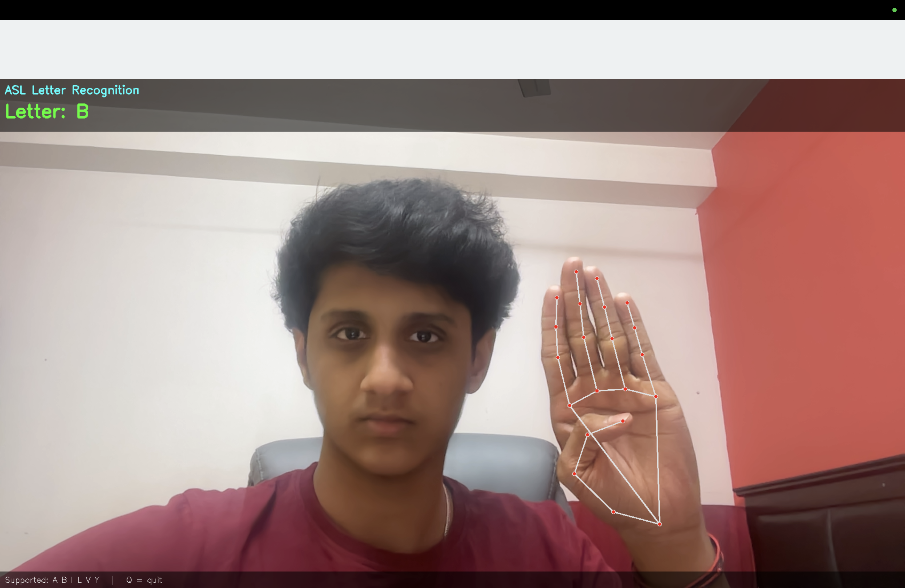
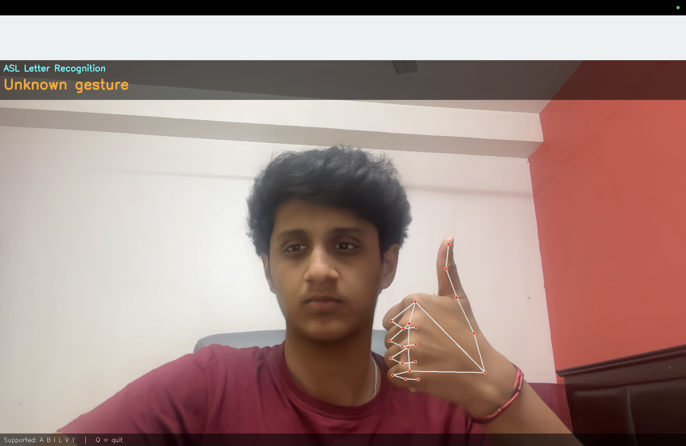
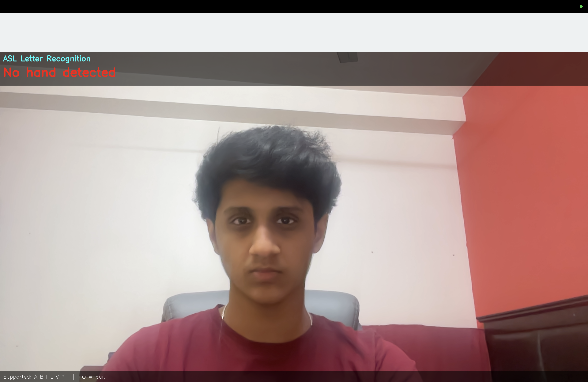

# ASL Letter Recognition (Sign Language Detection)

A real-time hand-sign recognition project built with Python, OpenCV, MediaPipe
and scikit-learn. It reads the webcam, finds the hand, and shows which of six
ASL letters is being signed.

Created by: Akshaay Suresh, Class 12, Our Own English High School Sharjah Boy's Branch

## Supported letters
**A, B, I, L, V, Y** only. This project does **not** recognise the full ASL
alphabet or ASL as a language (see Limitations).

## How it works
1. **OpenCV** reads frames from the webcam.
2. **MediaPipe Hands** (a pre-trained model by Google) finds 21 landmark points
   on the hand. It only detects the hand. It does not know sign language.
3. The points are converted into 42 numbers that describe the hand's shape,
   independent of where the hand is on the screen.
4. A **k-Nearest Neighbours (k-NN)** classifier from scikit-learn, trained on my
   own recorded examples, decides which letter the shape is closest to.
5. If the model is not confident enough, the screen shows **Unknown gesture**.

## Files
| File | Purpose |
|---|---|
| `step2_webcam.py` | Tests that the webcam works |
| `step3_hands.py` | Tests MediaPipe hand detection |
| `step4_collect.py` | Records training data into `hand_data.csv` |
| `step5_train.py` | Trains the k-NN model and saves `sign_model.joblib` |
| `step6_live.py` | First live recognition version |
| `step7_final.py` | Final program (smoothing, title, safe cleanup) |
| `hand_data.csv` | My recorded training data |
| `sign_model.joblib` | The trained model |

## Setup
Tested with Python 3.12 on macOS.

```
pip install -r requirements.txt
```

## How to run
1. (Optional) Record your own data: run `step4_collect.py`, press a/b/i/l/v/y
   to record each letter, then Q to quit.
2. Train: run `step5_train.py`.
3. Run the app: run `step7_final.py`. Press **Q** on the video window to quit.

On macOS, allow camera access for your Python editor when asked.

## Results
- Accuracy on a hidden 20% test split: **99.3%**. This number is optimistic
  because the test data came from the same recording session as the training
  data.
- Informal live testing: - A, B and L were recognised reliably. V and Y were
  sometimes shown as Unknown when the lighting was dim.
## Screenshots



## Limitations
- Only 6 static letters are supported. The other letters are not recognised.
  Many look alike to a camera (for example A, E, M, N, S and T are all fists).
- Letters J and Z need hand movement, so a single-frame method cannot do them.
- Trained on one person's hand, one camera and normal room light. It may be
  less accurate for other people, other lighting or other camera angles.
- Only one hand is tracked, and the palm should face the camera.
- It recognises letters only, not words or sentences, and it is not a
  replacement for a real ASL interpreter.
- Gestures outside the six letters are shown as "Unknown" only when the model
  is not confident, so a wrong guess is still possible.

## Possible improvements
- Record data from several people and in different lighting.
- Add more letters and test with a bigger dataset.
- Use a neural network or a sequence model to handle motion letters like J and Z.

## Tools used
Python, OpenCV, MediaPipe 0.10.14, scikit-learn, joblib, Spyder.
